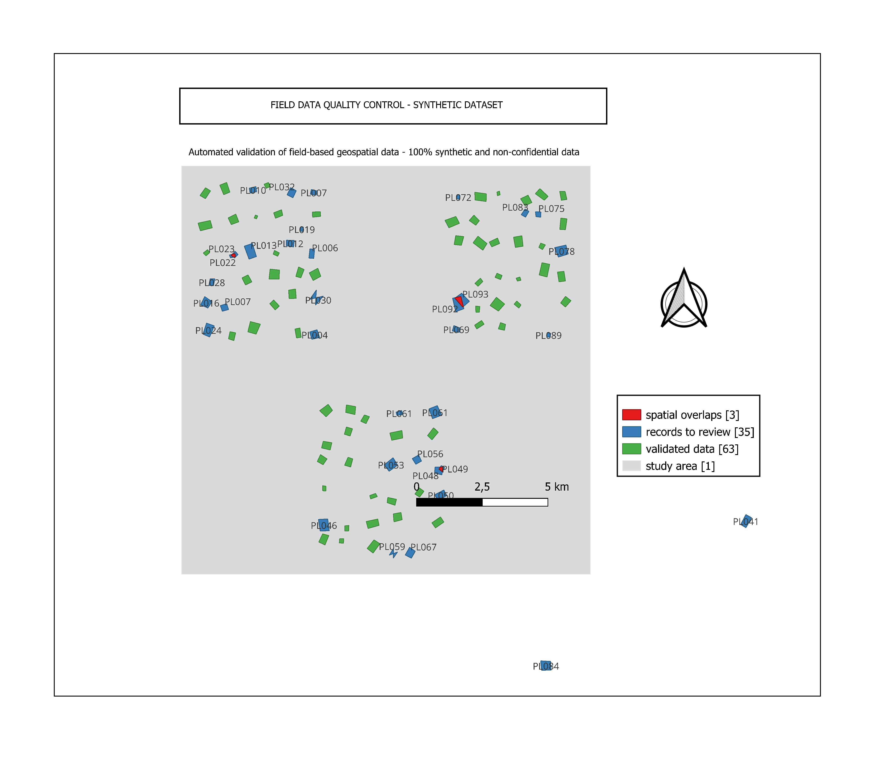

# Field Data Quality & GIS Workflow

From raw field data to validated geospatial information.

Designed and built by **Esther Bahati**.

Version française : [README_FR.md](README_FR.md)

## Overview

This portfolio project demonstrates a reproducible workflow for validating,
cleaning and preparing field-based geospatial data for GIS analysis and reporting.
The data are fully synthetic and deliberately include attribute and spatial
quality issues.

## Workflow

Synthetic raw data → Attribute quality control → Spatial validation → Status
assignment → Validated GIS-ready data → QGIS review and dashboard reporting.

## Technologies

Python, Pandas, NumPy, GeoPandas, Shapely, Matplotlib, GeoJSON, QGIS

## Installation

Install dependencies from the project root:

    python -m pip install -r requirements.txt

On Windows with Python 3.14:

    py -3.14 -m pip install -r requirements.txt

## Run the pipeline

    python src/run_pipeline.py --regenerate

On Windows:

    py -3.14 src/run_pipeline.py --regenerate

The command regenerates raw data, runs quality checks and writes all outputs.

| Option | Effect |
|---|---|
| `--regenerate` | Rebuild the synthetic raw dataset before running the checks. |
| `--no-figures` | Skip the PNG output (map, dashboard, diagram). |
| `--dry-run` | Run every check without writing any file. Useful when the GeoJSON outputs are open in QGIS. |

## Outputs

| File | Purpose |
|---|---|
| `outputs/quality_report.csv` | Quality-control metrics. |
| `outputs/record_status.csv` | Final status for each record. |
| `outputs/records_to_review.csv` | All detected issues and severity. |
| `outputs/validated_data.geojson` | GIS-ready validated records. |
| `outputs/records_to_review.geojson` | GIS layer of review and invalid records. |
| `outputs/spatial_overlaps.geojson` | Detected overlap pairs. |
| `outputs/map_overview.png` | Automated map overview. |
| `dashboard/dashboard.png` | Automated quality dashboard. |

## Validation rules

Twenty-two rules run on every record: 16 attribute checks and 6 spatial checks.
Each rule produces an issue with a severity, and the severity decides the status
of the record.

| Severity | Status | Meaning |
|---|---|---|
| Critical | `INVALID` | The record cannot be used as it is. |
| High or Medium | `REVIEW` | The record must be checked by the field team. |
| No issue | `VALID` | The record is exported to the validated dataset. |

The raw file is never modified. Only `VALID` records are exported to
`validated_data.csv` and `validated_data.geojson`.

## Current results

| Metric | Result |
|---|---:|
| Synthetic records processed | 100 |
| Valid records | 63 |
| Records requiring review | 31 |
| Invalid records | 6 |
| Total issues detected | 42 |
| Attribute issues | 25 |
| Spatial issues | 17 |
| Overlapping polygon pairs | 3 |
| Required-field completeness | 98.7 % |
| Deliberately injected errors re-detected | 37 / 37 |

The pipeline produces these metrics in `outputs/quality_report.csv`. A single
synthetic fault may create several issue records: both sides of a duplicate ID are
flagged, as are both parcels of an overlap.

## QGIS review

Open `outputs/validated_data.geojson`, `outputs/records_to_review.geojson` and
`outputs/spatial_overlaps.geojson` in QGIS. The guide
[docs/QGIS_MAP_GUIDE_FR.md](docs/QGIS_MAP_GUIDE_FR.md) describes how the final map
is built.

## Portfolio

Publication-ready visuals and the case study text are in
[portfolio/README.md](portfolio/README.md).

## Data and confidentiality

**Confidentiality Notice.** This portfolio project uses entirely synthetic data
created for demonstration purposes. No operational, organizational, producer,
geographic or other confidential data from professional projects are included.

## Author

**Esther Bahati**, designer and developer of this project.

- Portfolio: [eurekapx.com/portefolio](https://eurekapx.com/portefolio)
- LinkedIn: [esther-cbahati](https://www.linkedin.com/in/esther-cbahati)
- GitHub: [@Estherbh](https://github.com/Estherbh)
- Job opportunities: [estherbahaticb@gmail.com](mailto:estherbahaticb@gmail.com)
- Collaborations: [helloesther@eurekapx.com](mailto:helloesther@eurekapx.com)

## How to cite this work

If you use, adapt or reference this project, please credit the author:

> Bahati, E. (2026). *Field Data Quality & GIS Workflow*.
> https://github.com/Estherbh/Field-Data-Quality-GIS-WORKFLOW

Citation metadata is also available in [CITATION.cff](CITATION.cff)
(GitHub shows a "Cite this repository" button).

## License

Released under the [MIT License](LICENSE). You may reuse the code as long as
the copyright notice with the author's name and the license text are kept.
