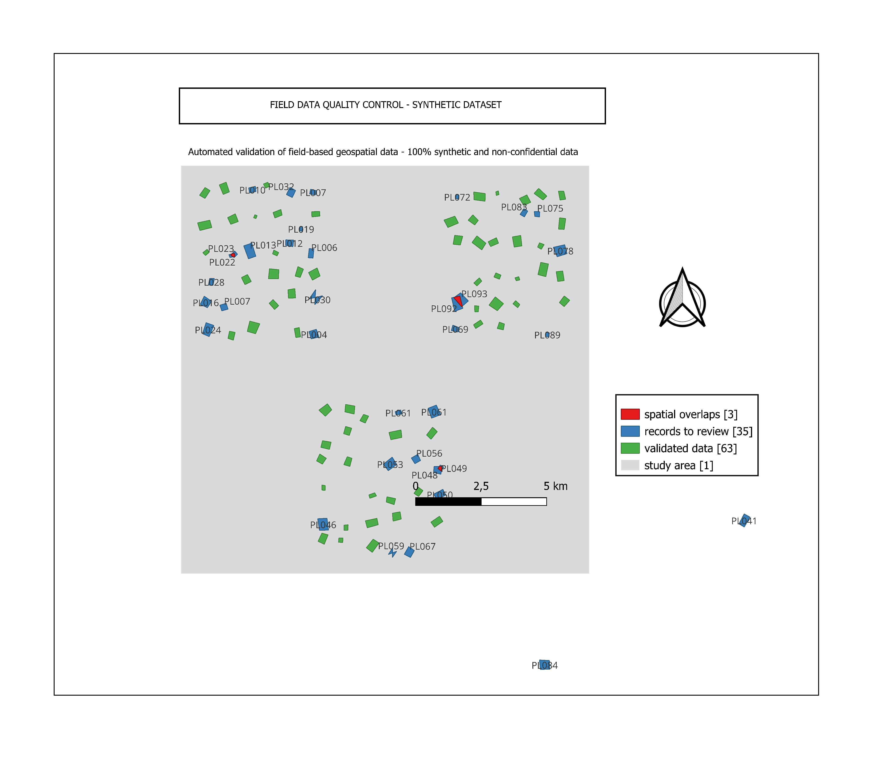

# Field Data Quality & GIS Workflow

Des données brutes de terrain à une information géospatiale validée.

Conçu et réalisé par **Esther Bahati**.

English version: [README.md](README.md)

## Présentation

Ce projet de portfolio démontre un workflow reproductible de validation, de
nettoyage et de préparation de données géospatiales de terrain en vue d'une
analyse SIG et d'un reporting. Les données sont entièrement synthétiques et
contiennent volontairement des problèmes attributaires et spatiaux.

## Workflow

Données brutes synthétiques → contrôle qualité attributaire → validation spatiale
→ attribution d'un statut → données validées prêtes pour le SIG → revue QGIS et
restitution par tableau de bord.

## Technologies

Python, Pandas, NumPy, GeoPandas, Shapely, Matplotlib, GeoJSON, QGIS

## Installation

Depuis la racine du projet :

    python -m pip install -r requirements.txt

Sous Windows avec Python 3.14 :

    py -3.14 -m pip install -r requirements.txt

## Lancer le pipeline

    python src/run_pipeline.py --regenerate

Sous Windows :

    py -3.14 src/run_pipeline.py --regenerate

La commande régénère les données brutes, exécute tous les contrôles et écrit
toutes les sorties.

Options disponibles :

| Option | Effet |
|---|---|
| `--regenerate` | Reconstruit le jeu de données brutes synthétiques avant les contrôles. |
| `--no-figures` | N'écrit pas les PNG (carte, tableau de bord, schéma). |
| `--dry-run` | Exécute tous les contrôles sans écrire aucun fichier. Utile quand les GeoJSON sont ouverts dans QGIS. |

## Sorties

| Fichier | Contenu |
|---|---|
| `outputs/quality_report.csv` | Indicateurs du contrôle qualité. |
| `outputs/record_status.csv` | Statut final de chaque enregistrement. |
| `outputs/records_to_review.csv` | Tous les problèmes détectés, avec leur gravité. |
| `outputs/validated_data.geojson` | Enregistrements validés, prêts pour le SIG. |
| `outputs/records_to_review.geojson` | Couche SIG des enregistrements à vérifier et invalides. |
| `outputs/spatial_overlaps.geojson` | Surfaces de chevauchement détectées. |
| `outputs/map_overview.png` | Carte générée automatiquement. |
| `dashboard/dashboard.png` | Tableau de bord qualité généré automatiquement. |

## Règles de validation

Vingt-deux règles s'appliquent à chaque enregistrement : 16 contrôles
attributaires et 6 contrôles spatiaux. Chaque règle produit un problème assorti
d'une gravité, et la gravité détermine le statut de l'enregistrement.

| Gravité | Statut | Signification |
|---|---|---|
| Critical | `INVALID` | L'enregistrement ne peut pas être utilisé en l'état. |
| High ou Medium | `REVIEW` | L'enregistrement doit être vérifié par l'équipe de terrain. |
| Aucun problème | `VALID` | L'enregistrement est exporté dans les données validées. |

Le fichier brut n'est jamais modifié. Seuls les enregistrements `VALID` sont
exportés dans `validated_data.csv` et `validated_data.geojson`.

## Résultats de l'exécution actuelle

| Indicateur | Résultat |
|---|---:|
| Enregistrements synthétiques traités | 100 |
| Enregistrements validés | 63 |
| Enregistrements à vérifier | 31 |
| Enregistrements invalides | 6 |
| Problèmes détectés | 42 |
| Problèmes attributaires | 25 |
| Problèmes spatiaux | 17 |
| Paires de parcelles qui se chevauchent | 3 |
| Complétude des champs obligatoires | 98,7 % |
| Erreurs injectées volontairement et retrouvées | 37 / 37 |

Le pipeline produit ces indicateurs dans `outputs/quality_report.csv`. Un même
défaut peut générer plusieurs problèmes : les deux enregistrements d'un doublon
d'identifiant sont signalés, comme les deux parcelles d'un chevauchement.

## Revue QGIS

Ouvrir `outputs/validated_data.geojson`, `outputs/records_to_review.geojson` et
`outputs/spatial_overlaps.geojson` dans QGIS. Le guide
[docs/QGIS_MAP_GUIDE_FR.md](docs/QGIS_MAP_GUIDE_FR.md) détaille la construction de
la carte finale.

## Portfolio

Les visuels prêts à publier et les textes de la case study se trouvent dans
[portfolio/LISEZMOI.md](portfolio/LISEZMOI.md).

## Données et confidentialité

**Note de confidentialité.** Ce projet de portfolio utilise exclusivement des
données synthétiques créées pour la démonstration. Aucune donnée opérationnelle,
organisationnelle, géographique ou confidentielle issue d'un projet professionnel
n'y figure.

## Auteure

**Esther Bahati**, conceptrice et développeuse de ce projet.

- Portfolio : [eurekapx.com/portefolio](https://eurekapx.com/portefolio)
- LinkedIn : [esther-cbahati](https://www.linkedin.com/in/esther-cbahati)
- GitHub : [@Estherbh](https://github.com/Estherbh)
- Opportunités professionnelles : [estherbahaticb@gmail.com](mailto:estherbahaticb@gmail.com)
- Collaborations : [helloesther@eurekapx.com](mailto:helloesther@eurekapx.com)

## Comment citer ce travail

Si vous utilisez, adaptez ou mentionnez ce projet, merci de créditer l'auteure :

> Bahati, E. (2026). *Field Data Quality & GIS Workflow*.
> https://github.com/Estherbh/Field-Data-Quality-GIS-WORKFLOW

Les métadonnées de citation sont aussi dans [CITATION.cff](CITATION.cff)
(GitHub affiche alors un bouton « Cite this repository »).

## Licence

Publié sous [licence MIT](LICENSE). Le code peut être réutilisé à condition de
conserver la mention de copyright avec le nom de l'auteure et le texte de la
licence.
